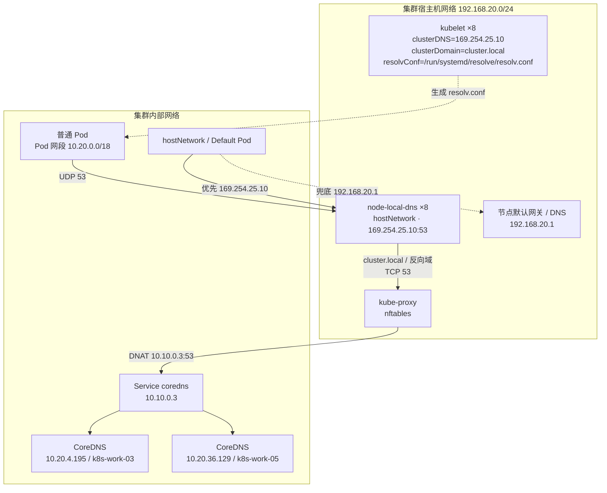

本文分两部分：

1. 浓缩说明 kubelet DNS 配置与 Pod `dnsPolicy` 的核心关系。
2. 给出当前实际环境的 DNS 架构与解析路径。

---

## 1. 总览

Pod 的 `/etc/resolv.conf` 由两层配置生成：

1. **Kubelet**：`clusterDNS`、`clusterDomain`、`resolvConf`
2. **Pod**：`dnsPolicy`、`dnsConfig`

---

## 2. Kubelet 的三个 DNS 配置

| 配置项 | 作用 | 生效范围 |
|---|---|---|
| `clusterDNS` | 集群 DNS 地址列表 | `ClusterFirst`、`ClusterFirstWithHostNet` |
| `clusterDomain` | 集群域名，默认 `cluster.local` | 生成集群 search 域 |
| `resolvConf` | 节点 resolver 文件路径 | `Default`、hostNetwork 回退；`ClusterFirst` 只取其 search 域 |

### 2.1 clusterDNS

- 命令行：`--cluster-dns`
- 配置字段：`clusterDNS: []string`
- 常见值：CoreDNS Service ClusterIP，或节点本地 DNS 缓存地址。

对 `ClusterFirst` / `ClusterFirstWithHostNet`，kubelet 用 `clusterDNS` **整体替换** Pod 的 nameserver：

```text
nameserver <clusterDNS>
```

注意：

- `clusterDNS` 为空时，`ClusterFirst` Pod 会触发 `MissingClusterDNS` 事件，并回退到 `Default`。
- 最终 nameserver 最多 3 个，超出会截断并产生 `DNSConfigForming` 事件。
- 指向节点本地缓存时，不经过 Service DNAT，但依赖每节点 DaemonSet；缓存不可用时，该节点 Pod DNS 会失败，kubelet 不会自动切回 Service ClusterIP。

### 2.2 clusterDomain

默认：

```text
cluster.local
```

对 `ClusterFirst` / `ClusterFirstWithHostNet`，kubelet 生成三个 search 域：

```text
<namespace>.svc.<clusterDomain>
svc.<clusterDomain>
<clusterDomain>
```

然后追加 `resolvConf` 中的 host search 域，并去重。

- `clusterDomain` 为空：不生成这三个集群 search 域。
- search 域限制：最多 32 个，总长最多 2048 字符。

### 2.3 resolvConf

- 命令行：`--resolv-conf`
- 默认：`/etc/resolv.conf`

作用：

```text
Default / hostNetwork 回退：
  nameserver = resolvConf 的 nameserver
  search     = resolvConf 的 search
  options    = resolvConf 的 options

ClusterFirst / ClusterFirstWithHostNet：
  nameserver = clusterDNS
  search     = 集群 search + resolvConf 的 search
  options    = ndots:5
```

关键点：

- **快照生效**：kubelet 在创建 Pod sandbox 时读取，修改文件不会更新运行中的 Pod，必须重建 Pod。
- **空值特殊**：`resolvConf: ""` 会写入回环地址并设置 `search .`，相当于禁用 DNS。
- **ClusterFirst 不继承 host options**：节点上的 `edns0`、`trust-ad` 等不会自动带入，需要时用 `dnsConfig.options` 显式添加。

#### 宿主机使用 systemd-resolved 时

systemd-resolved 默认会在 `127.0.0.53` 上提供 stub DNS，并把 `/etc/resolv.conf` 指向 stub 文件。这个地址只在**主机 network namespace 的 loopback** 上有效，Pod 有自己的 network namespace，无法访问它。

因此 kubelet 的 `resolvConf` 不能指向 stub 文件，而应指向 systemd-resolved 汇总的“真实上游”文件：

| 文件 | 内容 | 是否适合作为 `resolvConf` |
|---|---|---|
| `/etc/resolv.conf` | 可能是 stub 的软链，也可能是静态文件 | 取决于实际指向 |
| `/run/systemd/resolve/stub-resolv.conf` | `nameserver 127.0.0.53` 的 stub | **不适合**，Pod 内不可达 |
| `/run/systemd/resolve/resolv.conf` | systemd-resolved 汇总的真实上游 DNS 与 search 域 | **通常适合** |

典型配置：

```yaml
resolvConf: /run/systemd/resolve/resolv.conf
```

排查时先确认实际指向和 systemd-resolved 状态：

```bash
readlink -f /etc/resolv.conf
resolvectl status
cat /run/systemd/resolve/resolv.conf
```

判断标准：

- `resolvConf` 中的 nameserver 必须是 **Pod network namespace 可达** 的地址；
- 不能是仅主机 loopback 可达的 stub 地址；
- 如果 `/etc/resolv.conf` 是静态文件，或已直接指向真实上游，也可以直接使用；
- 如果系统调整了 systemd-resolved 的 `resolv.conf` 模式，应以 `resolvectl status` 和实际文件内容为准。

---

## 3. Kubelet 生成 Pod resolv.conf 的流程

```text
1. 读取 resolvConf，得到 base（nameservers、searches、options）
2. 根据 dnsPolicy 选择类型：
   - None                    → 空 base
   - ClusterFirstWithHostNet → cluster
   - ClusterFirst + 非 hostNetwork → cluster
   - ClusterFirst + hostNetwork    → host（回退 Default）
   - Default                 → host
3. cluster：
   nameservers = clusterDNS
   searches    = 集群 search + host search，去重
   options     = ndots:5
4. host：
   原样使用 base 的 nameservers、searches、options
5. 合并 dnsConfig：
   nameservers 追加去重
   searches    追加去重
   options     按名称合并，Pod 覆盖同名项
6. 应用限制：
   nameserver ≤ 3
   search ≤ 32 个且总长 ≤ 2048 字符
7. 生成 /etc/resolv.conf
```

两个关键分支：

- **cluster 类型**：nameserver 来自 `clusterDNS`；`clusterDNS` 为空则回退 host。
- **host 类型**：完全使用 `resolvConf`；hostNetwork + `ClusterFirst` 走这里。

---

## 4. dnsPolicy 与 hostNetwork 的关系

| dnsPolicy | hostNetwork | nameserver | search | options / 来源 |
|---|---:|---|---|---|
| `ClusterFirst`（默认） | false | `clusterDNS` | 集群 search + host search | `ndots:5` |
| `ClusterFirst` | true | `resolvConf` | `resolvConf` | 回退 `Default` |
| `ClusterFirstWithHostNet` | true | `clusterDNS` | 集群 search + host search | `ndots:5` |
| `Default` | false/true | `resolvConf` | `resolvConf` | `resolvConf` |
| `None` | false/true | 仅 `dnsConfig` | 仅 `dnsConfig` | 仅 `dnsConfig` |

补充：

- 不写 `dnsPolicy` 时，默认是 `ClusterFirst`，不是 `Default`。
- hostNetwork + `ClusterFirst` **不会**自动使用 `clusterDNS`，而是回退到节点 resolver。
- hostNetwork Pod 需要集群 DNS 时，使用 `ClusterFirstWithHostNet`。
- `Default` 表示继承节点 resolver；`None` 表示完全由 `dnsConfig` 决定。
- `ClusterFirstWithHostNet` 在 Windows 节点不支持。

---

## 5. dnsConfig 的作用

`dnsConfig` 在 policy 生成的 base 上追加/覆盖：

| 字段 | 规则 |
|---|---|
| `nameservers` | 追加并去重，最终最多 3 个 |
| `searches` | 追加并去重，最多 32 个、总长 2048 字符 |
| `options` | 按名称合并，Pod 覆盖同名 base option |

注意：

- `dnsPolicy: None` 时，`dnsConfig` 是唯一来源，且 `nameservers` 至少有一个。
- 追加 nameserver 不等于可靠故障转移；首个 DNS 返回 NXDOMAIN 时，不一定会询问下一个。
- `hostAliases` 写入的是 `/etc/hosts`，与 DNS policy 无关。

---

## 6. 常见细节

### ndots:5 与 search 放大

`ClusterFirst` 默认带 `ndots:5`。点数少于 5 的外部域名会先做 search 扩展，产生额外 NXDOMAIN 查询。

优化方式：

- 业务 Pod 设置 `ndots:2`：

```yaml
dnsConfig:
  options:
  - name: ndots
    value: "2"
```

- 或使用带尾点的 FQDN：`example.com.`

### 修改 resolvConf 不影响运行中的 Pod

kubelet 在 Pod 创建时生成 resolv.conf，之后不会动态更新。修改节点 resolver 或 kubelet `resolvConf` 后，必须重建 Pod。

### hostNetwork Pod 的 DNS 取决于节点 resolver

`hostNetwork + ClusterFirst` 使用 `resolvConf`。能否解析集群 Service 名，取决于节点 resolver 是否指向集群 DNS；这不是 kubelet 为它注入 `clusterDNS` 的结果。

### clusterDNS 指向节点本地缓存

- 不经过 Service DNAT；
- 依赖每节点 DaemonSet；
- 缓存进程不可用时，该节点 Pod DNS 失败；
- 缓存自身 upstream 应显式指向真实上游，避免转发回自己。

---

## 7. 实际环境架构

### 7.1 集群宿主机网络

- 节点网段：`192.168.20.0/24`
- 控制平面：`k8s-master-01 ~ 03`，`192.168.20.11 ~ 13`
- 工作节点：`k8s-work-01 ~ 05`，`192.168.20.21 ~ 25`
- 节点默认网关 / 节点 DNS：`192.168.20.1`

### 7.2 集群内部网络

- Pod 网段：`10.20.0.0/18`
- Service 网段：`10.10.0.0/18`
- CNI：Calico VXLAN
- kube-proxy：nftables 模式
- CoreDNS Service：`coredns`，ClusterIP `10.10.0.3`
- NodeLocalDNS：`169.254.25.10`

### 7.3 架构图



### 7.4 DNS 组件实际状态

| 组件 | 实际状态 |
|---|---|
| kubelet | `clusterDNS=169.254.25.10`、`clusterDomain=cluster.local`、`resolvConf=/run/systemd/resolve/resolv.conf` |
| NodeLocalDNS | DaemonSet 8/8，hostNetwork，监听 `169.254.25.10:53` |
| CoreDNS | 2 副本；Service `coredns`，ClusterIP `10.10.0.3`；端点 `10.20.4.195`、`10.20.36.129` |
| NodeLocalDNS 集群域转发 | `cluster.local`、`in-addr.arpa`、`ip6.arpa` → `10.10.0.3:53`，`force_tcp` |
| NodeLocalDNS 外部转发 | `. :53` → 外部上游 DNS |
| CoreDNS 外部转发 | `forward .` → 外部上游 DNS |
| 节点 host resolver 快照 | `169.254.25.10`、`192.168.20.1`；search 为两个集群域 |

NodeLocalDNS 集群域缓存：

```text
cluster.local: success 9984 30s / denial 9984 5s
in-addr.arpa: cache 30s
ip6.arpa: cache 30s
```

### 7.5 实际解析路径

| 场景 | 路径 |
|---|---|
| 集群 Service FQDN / 集群 IP 反向解析 | Pod → `169.254.25.10:53` → TCP → `10.10.0.3:53` → kube-proxy nftables DNAT → CoreDNS → `kubernetes` 插件 |
| 普通 Pod 访问外部域名 | Pod → NodeLocalDNS `. :53` → 外部上游 DNS；不经过 CoreDNS |
| hostNetwork / Default Pod 访问外部域名 | 先走 host resolver 的 `169.254.25.10` → NodeLocalDNS → 外部上游 DNS；`192.168.20.1` 作为第二 nameserver 兜底 |
| CoreDNS 直接收到外部查询 | CoreDNS `forward .` → 外部上游 DNS |
| 节点自身 DNS | 节点 systemd-resolved 上游为 NodeLocalDNS；外部域名再由 NodeLocalDNS 转发 |

### 7.6 关键说明

- NodeLocalDNS 的 `. :53` 已显式指向外部上游，没有使用 `/etc/resolv.conf`；否则会因 host resolver 包含 `169.254.25.10` 而形成自转发。
- 节点网关 `192.168.20.1` 不是集群 DNS；不要用它解析 `cluster.local`。
- NodeLocalDNS 无自动回退 CoreDNS Service 的能力，节点上的 DaemonSet 不可用会影响该节点 Pod 的 DNS。
- Pod 内 resolv.conf 是创建时快照；当前 NodeLocalDNS Pod 内为 `192.168.20.1`，而新建 hostNetwork Pod 会得到 `169.254.25.10 + 192.168.20.1`。
